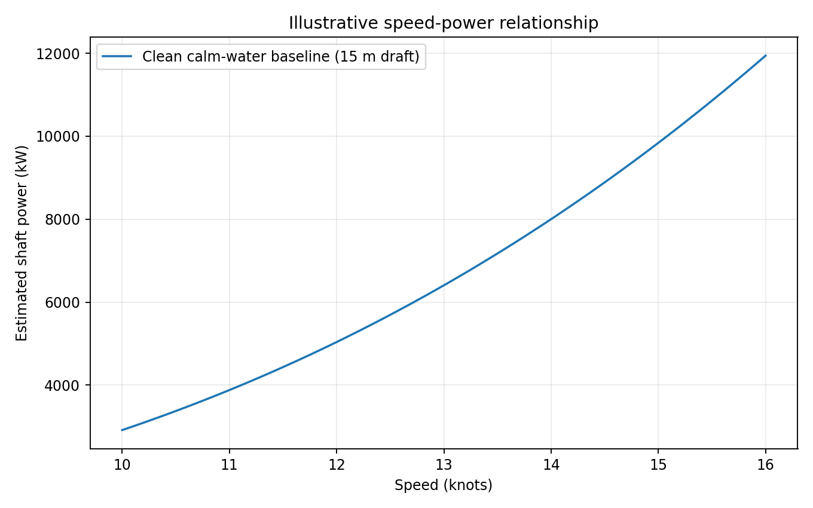
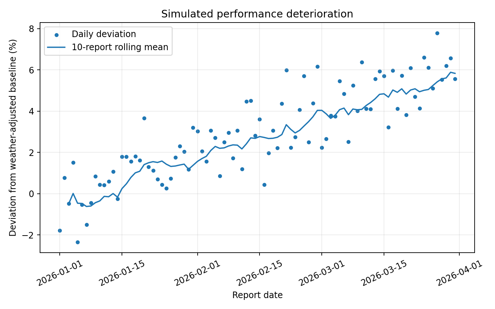

## Key Analysis Results

This independent learning project analyzes 90 synthetic daily noon reports for a simulated Capesize bulk carrier.

| Performance Indicator | Result |
|---|---:|
| Daily reports | 90 |
| Average fuel consumption | 34.99 tonnes/day |
| Total observed fuel consumption | 3,148.87 tonnes |
| Clean-hull, calm-water baseline | 2,909.52 tonnes |
| Aggregate deviation from baseline | +8.23% |
| Weather-adjusted deviation, first 15 reports | 0.01% |
| Weather-adjusted deviation, last 15 reports | 5.60% |

The simulated weather-adjusted deviation increased by 5.59 percentage points between the first and last 15 reports. This trend is consistent with the deterioration intentionally introduced into the synthetic dataset; it is not independent evidence of real-world hull fouling.

## Performance Visualizations

### Speed-Power Relationship

### Simulated Performance Deterioration

## Illustrative Financial Scenario

A hypothetical 5.6% fuel-consumption improvement was evaluated using an assumed baseline consumption of 35 tonnes/day and a fuel price of $600 per tonne.

| Metric | Scenario Result |
|---|---:|
| Potential fuel reduction | 1.96 tonnes/day |
| Daily gross fuel-cost savings | $1,176 |
| Gross savings over 30 operating days | $35,280 |

These are hypothetical scenario outputs, not measured savings or a validated maintenance business case. Maintenance costs, downtime, operating conditions and other commercial factors are excluded.
